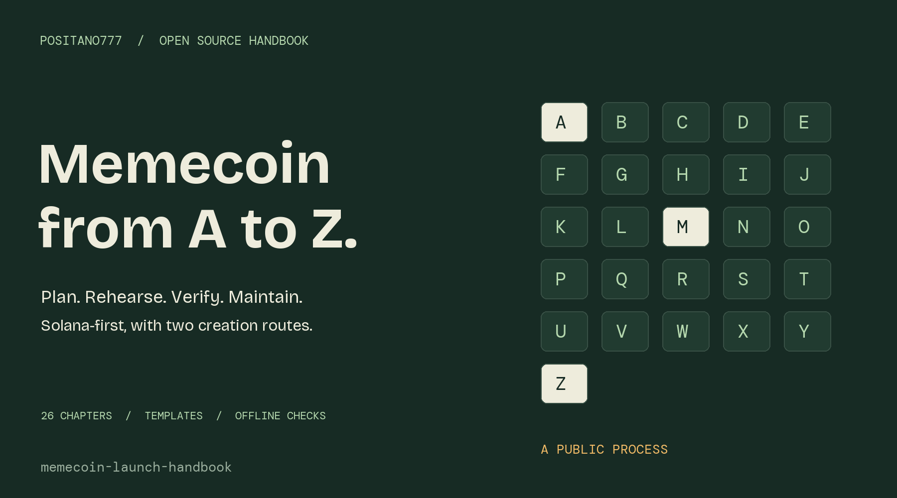
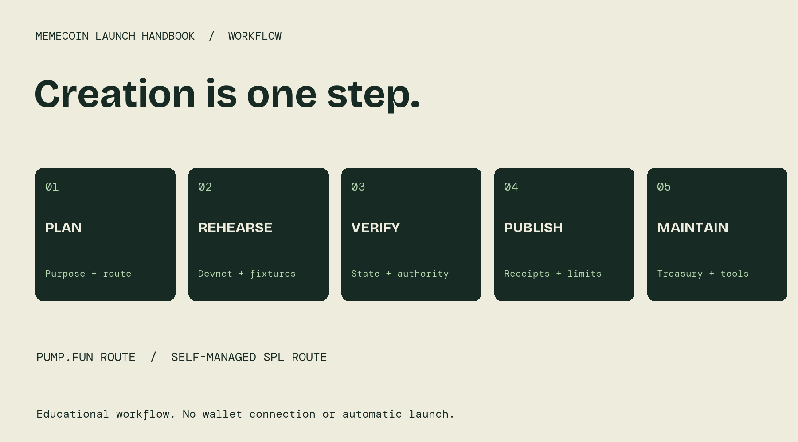

# Memecoin Launch Handbook

**A to Z of planning, creating, documenting, and maintaining a Solana memecoin.** Two creation routes, 26 practical chapters, reusable public templates, and a dependency-free plan checker. Maintained by [Positano777](https://x.com/positano777).

This is an original community handbook, not a token launch service. It does not create a wallet, ask for signing keys, submit a transaction, promise returns, or certify a launch. No token was created while preparing this release. Technical references were checked on **2026-10-21**; platform settings and fees must be rechecked at use time.

## Choose your path

| Path | What it means | Start |
| --- | --- | --- |
| pump.fun creator | Use the platform's creation and curve/migration workflow; inspect current parameters | [Route choice](guide/j-journey-route.md), then [pump.fun](guide/l-pumpfun.md) |
| Self-managed SPL token | Configure a mint, metadata, authorities, distribution, and market separately | [Program choice](guide/c-chain-program.md), then [devnet exercise](guide/m-mint-devnet.md) |
| Contributor or reviewer | Check plans, receipts, tool assumptions, and maintenance evidence | [Quality gates](guide/q-quality-gates.md), [verification](guide/v-verify.md), [contributing](CONTRIBUTING.md) |

An arbitrary SPL mint is not automatically a pump.fun coin. Self-managed allocation examples are not platform creation parameters. Mainnet is not a demo environment.

## Start in five steps

1. Fill the [project brief](templates/project-brief.md) and choose one route.
2. Copy the appropriate [public example plan](templates/) locally. Its placeholder allocations are illustrative, not a recommendation.
3. With Node.js 22+, run a local check, with no installation required:

```sh
node tools/preflight.mjs templates/plan.self-managed.example.json
node tools/preflight.mjs templates/plan.pumpfun.example.json
node --test test/*.test.mjs
```

4. Read pending warnings, rehearse the applicable pieces, and complete the evidence templates.
5. Use the launch-day checklist only after independent review and confirmation of current state.

The checker returns exit **2** for inconsistent plans and **1** for invalid input. Exit **0** only means its local checks found no blocking inconsistency; warnings can remain. It is never launch authorization, live verification, or a legal review.

For a fresh test signer or the separate metadata wizard route, use [disposable devnet setup](guide/devnet-setup.md).

## A-to-Z index

| Chapter | What you produce |
| --- | --- |
| [A - Aim and audience](guide/a-aim.md) | See chapter deliverable and exit check |
| [B - Budget before transactions](guide/b-budget.md) | See chapter deliverable and exit check |
| [C - Choose chain and token program](guide/c-chain-program.md) | See chapter deliverable and exit check |
| [D - Decimals and exact units](guide/d-decimals.md) | See chapter deliverable and exit check |
| [E - Explain every authority](guide/e-authority-design.md) | See chapter deliverable and exit check |
| [F - Funding and wallet roles](guide/f-funding-wallets.md) | See chapter deliverable and exit check |
| [G - Give the token accurate metadata](guide/g-metadata.md) | See chapter deliverable and exit check |
| [H - Host durable public assets](guide/h-hosting.md) | See chapter deliverable and exit check |
| [I - Identity, rights, and disclosures](guide/i-identity-rights.md) | See chapter deliverable and exit check |
| [J - Join the right creation route](guide/j-journey-route.md) | See chapter deliverable and exit check |
| [K - Keep credentials out of launch material](guide/k-keys.md) | See chapter deliverable and exit check |
| [L - Launch through pump.fun](guide/l-pumpfun.md) | See chapter deliverable and exit check |
| [M - Mint a rehearsal token on devnet](guide/m-mint-devnet.md) | See chapter deliverable and exit check |
| [N - Network rehearsal and evidence](guide/n-rehearse.md) | See chapter deliverable and exit check |
| [O - Observe final authority state](guide/o-ownership-final.md) | See chapter deliverable and exit check |
| [P - Pools, price, and liquidity control](guide/p-pools.md) | See chapter deliverable and exit check |
| [Q - Quality gates before a public launch](guide/q-quality-gates.md) | See chapter deliverable and exit check |
| [R - Release a verifiable launch record](guide/r-receipts.md) | See chapter deliverable and exit check |
| [S - Security and incident response](guide/s-security-response.md) | See chapter deliverable and exit check |
| [T - Treasury, fees, and contributor funding](guide/t-treasury.md) | See chapter deliverable and exit check |
| [U - Users and community onboarding](guide/u-users.md) | See chapter deliverable and exit check |
| [V - Verify rather than certify](guide/v-verify.md) | See chapter deliverable and exit check |
| [W - Watch after launch](guide/w-watch.md) | See chapter deliverable and exit check |
| [X - X posts and public communications](guide/x-sharing.md) | See chapter deliverable and exit check |
| [Y - Year-one maintenance](guide/y-year-one.md) | See chapter deliverable and exit check |
| [Z - Zero ambiguity when plans change](guide/z-closure.md) | See chapter deliverable and exit check |

## What makes this useful

- Separate platform and self-managed paths instead of mixing incompatible tutorials.
- Exact decimal/base-unit handling, public authority policies, and route-specific planning checks.
- Devnet-only command examples with clear irreversible-action notes.
- Receipts and operational templates extending beyond the creation button.
- Source links and [a maintenance/reverification register](SOURCES.md).



## Templates

[Project brief](templates/project-brief.md) · [authority matrix](templates/authority-matrix.md) · [wallet roles](templates/wallet-register.md) · [disclosures](templates/disclosures.md) · [budget](templates/budget.csv) · [metadata](templates/token-metadata.example.json) · [rehearsal](templates/rehearsal.md) · [launch checklist](templates/launch-checklist.md) · [launch receipt](templates/launch-receipt.md) · [treasury policy](templates/treasury-policy.md) · [incident runbook](templates/incident-runbook.md) · [operations](templates/operations.md) · [announcements](templates/announcements.md) · [closure](templates/closure.md).

## Tool and content scope

The code performs offline checks on supplied public JSON. It checks supported supply ranges, allocation arithmetic, route differences, review flags, some authority-policy consistency, and obvious credential fields/URLs. It does not validate on-chain addresses, URL reachability, program behavior, fee accuracy, legal status, or economic outcomes. It is not a comprehensive secret scanner or full JSON-schema validator. It supports a deliberately small subset of token settings.

No live minting command was executed. Eighteen automated tests cover the local checker. Command examples were checked against linked official documentation, not tested using your wallet. Read [VALIDATION.md](VALIDATION.md) and [SECURITY.md](SECURITY.md).

## Community tools and attribution

Build on official Solana/Pump/Metaplex interfaces where appropriate. Link upstream source and verify its current license instead of copying ambiguous code. This handbook does not vendor a launch engine or claim affiliation with a platform.

- [Community tools catalog](https://github.com/Positano777/awesome-pumpfun-open-source)
- [Launch evidence toolbox](https://github.com/Positano777/pumpfun-community-tools)
- [IDL Drift Watch](https://github.com/Positano777/idl-drift-watch)

MIT licensed original text, templates, code, and graphics. Third-party linked material retains its own terms. See [LICENSE](LICENSE). Contributions need reproducible evidence and no credentials; see [CONTRIBUTING.md](CONTRIBUTING.md).
